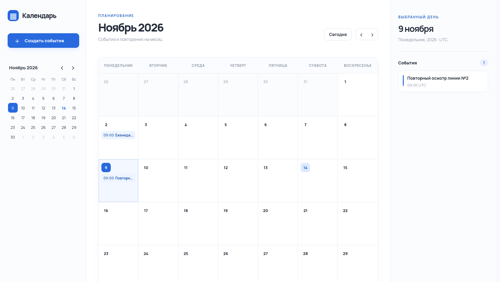
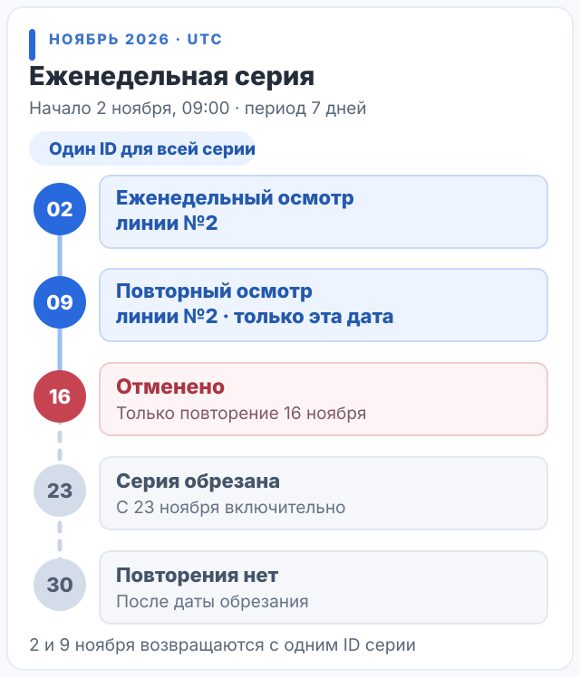

# Recurring Calendar API

Календарь и API повторяющихся событий на Django: создание серии, просмотр дня, изменение или отмена отдельного повтора и обрезание серии. Есть браузерный календарь; локальный профиль использует SQLite.



## Быстрый запуск

Из корня проекта (Python 3.14):

```bash
python3.14 -m venv .venv
.venv/bin/python -m pip install -r requirements.txt
.venv/bin/python manage.py migrate
.venv/bin/python manage.py runserver localhost:8000
```

Откройте `http://localhost:8000/`. По умолчанию действует локальный профиль. Другие профили и production описаны в [инструкции по развёртыванию](docs/deployment.md).

Основные файлы: маршруты — `config/urls.py`, настройки профилей — `config/settings.py`, правила и HTTP-обработчики — `events/models.py` и `events/views.py`, интерфейс — `events/templates/events/calendar.html` и `events/static/events/`. Подробности — в [техническом отчёте](docs/technical-report.md).

Форматирование проверяется отдельными инструментами разработки (Python 3.14 и Node.js):

```bash
python3.14 -m venv .venv-dev
.venv-dev/bin/python -m pip install -r requirements-dev.txt
npm ci
.venv-dev/bin/ruff check .
.venv-dev/bin/ruff format --check .
npm run format:web:check
```

`ruff` исключает сгенерированные миграции; `node_modules` и `.venv-dev` не входят в Git.

## Пять маршрутов ТЗ

| Метод и маршрут | Результат |
| --- | --- |
| `POST /add/` | Создать событие или серию; `201` и `id` серии |
| `GET /events/{year}/{month}/{day}/` | События дня; `200` и массив, включая `[]` для пустого дня |
| `POST /update/{id}/{year}/{month}/{day}/` | Переименовать один повтор; `204` |
| `POST /remove/{id}/{year}/{month}/{day}/` | Отменить один повтор; `204` |
| `POST /remove-next/{id}/{year}/{month}/{day}/` | Удалить этот и следующие повторы; `204` |

Форматы запросов, ошибки и ответы: [OpenAPI](docs/openapi.yaml). Ожидаемая пустая выдача `[]` в примерах предполагает чистую демонстрационную базу; в заполненной базе на те же даты могут быть другие события.

## Как устроены повторы



В [сценарии демо](docs/demo.md) 9 ноября переименовано только одно повторение, 16 ноября отменено только одно повторение, а с 23 ноября включительно серия обрезана.

Для еженедельных осмотров 2, 9, 16, 23 и 30 ноября 2026 года хранится одна `EventsSeries` с началом 2 ноября, `period=7` и общим `id`. Осмотры на каждую дату вычисляются при чтении; отдельных строк событий для них нет. Переименование 9 ноября и отмена 16 ноября сохраняются как две `EventException`. Обрезание с 23 ноября записывает `cutoff_date=2026-11-23` в серию, поэтому 23 и 30 ноября не выдаются. Осмотр 2 ноября остаётся исходным, а 9 ноября — переименованным.

Django-монолит подходит заданию: API, календарь, правила повторений и хранение данных работают в одном приложении. Это упрощает локальный запуск и проверку сценария без отдельных сервисов.

## Демо и приёмка

[Сценарий демо](docs/demo.md) показывает осмотры за 2–3 минуты: создание серии, переименование 9 ноября, отмену 16 ноября, обрезание с 23 ноября и проверку после перезагрузки. [Исполняемый curl-сценарий](docs/demo.md#проверка-api-через-curl) повторяет те же действия через API.

[Результаты приёмки](docs/submission-checklist.md): проверены пять исходных маршрутов и HTTP-статусы, браузерный сценарий в Firefox, тесты для local, private и production, OpenAPI и отсутствие новых миграций. Проверки выполнялись на временных данных; ограничения публичного развёртывания перечислены в отчёте.

[Технический отчёт](docs/technical-report.md) содержит стек, подтверждения проверок, границу интеграции и открытые пункты.
