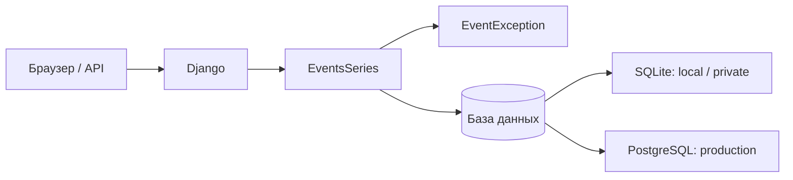

# Recurring Calendar API

Календарь и API повторяющихся событий на Django. Local и private используют SQLite; production — PostgreSQL.

[Быстрый запуск](#быстрый-запуск) · [OpenAPI](docs/openapi.yaml) · [Демо на 3 минуты](docs/demo.md)


*Итог демо: 2 ноября — исходное событие, 9 ноября — переименованное; 16 ноября отменено, 23 и 30 ноября удалены обрезанием серии.*

## Быстрый запуск

Из корня проекта:

```bash
python3.14 -m venv .venv
.venv/bin/python -m pip install -r requirements.txt
.venv/bin/python manage.py migrate
.venv/bin/python manage.py runserver localhost:8000
```

API доступен по `http://localhost:8000`. Миграции создают таблицы `EventsSeries` и `EventException` в `db.local.sqlite3` при запуске по умолчанию. Для проверок без изменения основной базы: `.venv/bin/python manage.py test events`.

[Контракт API](docs/openapi.yaml) · [Демо на 2–3 минуты](docs/demo.md)

## Как устроены повторы



`EventsSeries` задаёт правило повтора; `EventException` хранит переименование или отмену конкретной даты этой серии. SQLite и PostgreSQL — альтернативы, выбираемые профилем запуска.

Например, создание недельного осмотра 2 ноября 2026 года сохраняет **одну** `EventsSeries` с `period=7` и одним ID. Повторы вычисляются при чтении, поэтому записи на каждый понедельник заранее не нужны. Переименование 9 ноября и отмена 16 ноября добавляют по одному `EventException` для той же серии. Обрезание с 23 ноября записывает `cutoff_date=2026-11-23` в `EventsSeries`: 23 ноября и все следующие даты не показываются. Соседние ранние повторы сохраняются.

## Профили запуска

Профиль выбирается переменной `CALENDAR_PROFILE`. По умолчанию действует `local`: база `db.local.sqlite3`, пять исходных API-маршрутов доступны без входа, POST работает с обычным `curl`, сервер слушает `localhost:8000`. Защищённый профиль `private` использует `db.sqlite3`, сеансовый вход Django и CSRF. Старые серии без владельца скрыты до явного назначения.

```bash
# Локальный профиль
CALENDAR_PROFILE=local .venv/bin/python manage.py migrate
CALENDAR_PROFILE=local .venv/bin/python manage.py runserver localhost:8000

# Защищённый профиль (в другом запуске)
CALENDAR_PROFILE=private .venv/bin/python manage.py migrate
CALENDAR_PROFILE=private .venv/bin/python manage.py createsuperuser
CALENDAR_PROFILE=private .venv/bin/python manage.py runserver localhost:8000
```

В защищённом профиле откройте `http://localhost:8000/login/`. Выход доступен кнопкой календаря (POST `/logout/`). Для назначения старых серий сначала просмотрите список: `CALENDAR_PROFILE=private .venv/bin/python manage.py assign_series USERNAME 1 2`, затем повторите с `--apply`. Команда принимает только существующие серии без владельца и не меняет исключения или дату обрезания.

## Интерфейс календаря

После запуска откройте `http://localhost:8000/`. Слева находится навигация и создание события, в центре — месяц, справа — события выбранного дня. На узком экране панель дня расположена ниже сетки. В форме время вводится в UTC; повторение задаётся как одно событие, ежедневно, еженедельно или каждые N дней. Кнопки в подробностях события изменяют только выбранное повторение либо обрезают серию с выбранной даты включительно.

Сетка месяца использует `GET /events/range/?start=YYYY-MM-DD&end=YYYY-MM-DD`. Обе даты включены; диапазон содержит от 1 до 42 календарных дней. Ответ: `{"days":[{"date":"2026-11-09","events":[{"id":1,"name":"Смена","time":"09:00"}]}]}`. Даты и время — UTC. Для неверных параметров или диапазона возвращается `400`, для другого метода — `405`. Исходные пять API-маршрутов остаются доступными по прежнему контракту.

Браузерный прогон на временной базе: установите Selenium (`.venv/bin/python -m pip install selenium`) и Firefox с geckodriver, затем выполните `.venv/bin/python scripts/browser_check.py`. Скрипт проверяет создание, переименование, два вида удаления, сохранность после перезагрузки и отсутствие горизонтальной прокрутки на узкой ширине; изображения сохраняются в `screenshots/`.

Скриншоты проверенного состояния: [основной экран](screenshots/calendar-desktop.png), [форма события](screenshots/event-form.png), [узкий экран](screenshots/calendar-mobile.png).

Точная проверка viewport 360 и 390 CSS-пикселей через Firefox WebDriver BiDi: `.venv/bin/python scripts/mobile_viewport_check.py`. Измерения ширины, сценарии и скриншоты приведены в [MOBILE_QA.md](MOBILE_QA.md).

## Договорённости API

| Метод и путь | Успешный ответ |
| --- | --- |
| `POST /add/` | `201`, `{"id": <id серии>}` |
| `GET /events/{year}/{month}/{day}/` | `200`, массив объектов `{"name": ..., "id": ...}`; пустой день — `[]` |
| `POST /update/{id}/{year}/{month}/{day}/` | `204`, новое имя только у этого повторения |
| `POST /remove/{id}/{year}/{month}/{day}/` | `204`, отмена только этого повторения |
| `POST /remove-next/{id}/{year}/{month}/{day}/` | `204`, отмена указанного повторения и всех следующих |

`/add/` принимает JSON ровно с полями `name` (строка), `start_at` (целое число секунд Unix UTC) и `period` (целое число дней от `1` до `2**63 - 1` или `null`). `period: 7` означает неделю, `period: 1` — день, `null` — одно событие. JSON `true` и `false` не считаются целыми числами. `/update/` принимает JSON ровно с полем `name` (строка). Остальным маршрутам тело запроса не требуется.

Даты в URL и дата начала события рассматриваются по UTC. Время `start_at` сохраняется, но повторения определяются календарной датой UTC: первое происходит в дату начала, следующие — каждые `period` дней. Один `id` принадлежит всей серии; конкретное повторение задаётся парой `id` и дата. Переименование и отмена сохраняются в `EventException`, не меняя остальные повторения. `cutoff_date` в `EventsSeries` — первая отменённая дата, то есть отмена через `/remove-next/` **включает** дату в URL.

Некорректный JSON, поля, timestamp вне диапазона и невозможная дата дают `400`. Попытка изменить или отменить несуществующую серию либо невидимое повторение даёт `404`. Неподдерживаемый HTTP-метод даёт `405`. У POST-маршрутов есть локальное исключение CSRF для вызова обычным `curl`; глобальный `CsrfViewMiddleware` остаётся включённым.

## Короткое демо

В одном терминале запустите сервер, как указано выше. В другом:

```bash
BASE=http://localhost:8000
SERIES_ID=$(curl -fsS -X POST "$BASE/add/" -H 'Content-Type: application/json' -d '{"name":"Смена","start_at":1794214800,"period":7}' | .venv/bin/python -c 'import json,sys; print(json.load(sys.stdin)["id"])')
echo "Series ID: $SERIES_ID"

curl -i "$BASE/events/2026/11/9/"   # начало: Смена
curl -i "$BASE/events/2026/11/16/"  # следующее: Смена
curl -i "$BASE/events/2026/11/10/"  # между ними: []

curl -i -X POST "$BASE/update/$SERIES_ID/2026/11/16/" -H 'Content-Type: application/json' -d '{"name":"Новая смена"}'
curl -i "$BASE/events/2026/11/16/"  # Новая смена
curl -i "$BASE/events/2026/11/9/"   # по-прежнему Смена

curl -i -X POST "$BASE/remove/$SERIES_ID/2026/11/23/"
curl -i "$BASE/events/2026/11/23/"  # []

curl -i -X POST "$BASE/remove-next/$SERIES_ID/2026/11/30/"
curl -i "$BASE/events/2026/11/30/"  # []
curl -i "$BASE/events/2026/12/7/"   # []
curl -i "$BASE/events/2026/11/16/"  # Новая смена сохранилась

curl -i -X POST "$BASE/add/" -H 'Content-Type: application/json' -d '{"name":"Один раз","start_at":1794214800,"period":null}' # 201
curl -i -X POST "$BASE/add/" -H 'Content-Type: application/json' -d '{"name":"Ошибка","start_at":1794214800,"period":0}' # 400
```

Все три операции изменения возвращают `204` без тела. `GET` возвращает `200`; создание — `201`. `SERIES_ID` берётся из ответа сервера, поэтому демо можно повторить на уже заполненной базе.

## Доступ и CSRF

В профиле `private` календарь и все API-маршруты требуют входа. Серии доступны только своему владельцу; чужой id при изменении даёт `404`. Браузер передаёт CSRF-токен в заголовке `X-CSRFToken` для POST. В профиле `local` сохраняется прежний договор API без входа и CSRF для локального задания.

## Нагрузочная проверка

Запуск: `.venv/bin/python scripts/benchmark.py`. Скрипт создаёт временную копию проекта и новую SQLite-базу, применяет миграции, наполняет базу и запускает локальный сервер Django. Он измеряет чтение дня и смешанную нагрузку (при 1 000 серий 9 чтений и 3 создания, при 10 000 серий 4 чтения и 2 создания) при 1, 4 и 8 одновременных клиентах. Вывод — JSON по каждому сценарию с длительностью, RPS, p50, p95, p99, максимумом, размером ответа и HTTP-статусами. `.venv/bin/python scripts/benchmark.py --long` выполняет 60 и 30 запросов на сценарий. Результаты до и после оптимизации чтения, включая ограничения выборки, сохранены в [BENCHMARK.md](BENCHMARK.md) и [BENCHMARK_AFTER.md](BENCHMARK_AFTER.md). Это локальный ориентир для разработки интерфейса, не показатель публичного сервера.

## Production (отдельный профиль)

Production использует PostgreSQL, вход Django и изоляцию серий по владельцу. Старые серии с `owner=NULL` скрыты; назначайте их через `assign_series` после проверки владельцев. Для публичного сервера установите переменные из `.env.example` в process manager или секретах хостинга. Django **не читает `.env` сам**. Для ручной локальной проверки можно выполнить `set -a; source .env; set +a`, предварительно создав свой `.env` (он игнорируется Git). Пример не содержит рабочих секретов.

Обязательные переменные: `CALENDAR_PROFILE=production`, `SECRET_KEY` (длинный случайный ключ), `ALLOWED_HOSTS` (список имён через запятую), `CSRF_TRUSTED_ORIGINS` (полные HTTPS origins через запятую), `POSTGRES_DB`, `POSTGRES_USER`, `POSTGRES_PASSWORD`, `POSTGRES_HOST`. `POSTGRES_PORT` по умолчанию `5432`. При отсутствии обязательных значений запуск завершается с сообщением о переменной. `CALENDAR_TRUST_PROXY_HTTPS=1` ставьте только если доверенный reverse proxy удаляет присланный клиентом `X-Forwarded-Proto` и выставляет его сам. Без этого Django не доверяет forwarded-заголовку. `CALENDAR_HTTPS_ENABLED=0` разрешён только для локальной HTTP-проверки production-конфигурации; по умолчанию редирект на HTTPS и secure cookies включены. Обе переменные принимают только `0` или `1`; пустые и другие значения вызывают ошибку с названием переменной. По умолчанию HTTPS включён, доверие proxy выключено. TLS завершается на reverse proxy, который передаёт трафик Gunicorn по закрытому каналу. HSTS действует только для текущего хоста, без preload и includeSubDomains.

```bash
python3.14 -m venv .venv
.venv/bin/python -m pip install -r requirements.txt
# Экспортируйте переменные окружения перед следующими командами.
.venv/bin/python manage.py migrate
.venv/bin/python manage.py createsuperuser
.venv/bin/python manage.py collectstatic --noinput
.venv/bin/python manage.py check --deploy
.venv/bin/gunicorn config.wsgi:application --bind 127.0.0.1:8000 --workers 2
```

WhiteNoise обслуживает собранные статические файлы из `staticfiles/` через Gunicorn. Запускайте `collectstatic` после каждого обновления ресурсов. `psycopg[binary]` — PostgreSQL-драйвер, `gunicorn` — WSGI-сервер, `whitenoise` — обслуживание статики. Для проверки с локальным контейнером: `docker compose up -d --wait postgres`, затем используйте `POSTGRES_HOST=127.0.0.1 POSTGRES_PORT=5433 POSTGRES_PASSWORD=local-test-only`; не используйте этот пароль публично. При HTTP-проверке также задайте `CALENDAR_HTTPS_ENABLED=0`, `ALLOWED_HOSTS=localhost,127.0.0.1` и `CSRF_TRUSTED_ORIGINS=http://localhost:8000`.

Резервное копирование и проверка восстановления в **отдельную пустую тестовую базу** (подставьте свои соединения, не восстанавливайте поверх пользовательской базы):

```bash
pg_dump -Fc -h "$POSTGRES_HOST" -p "${POSTGRES_PORT:-5432}" -U "$POSTGRES_USER" -d "$POSTGRES_DB" -f calendar.dump
createdb -h "$POSTGRES_HOST" -p "${POSTGRES_PORT:-5432}" -U "$POSTGRES_USER" calendar_restore_test
pg_restore -h "$POSTGRES_HOST" -p "${POSTGRES_PORT:-5432}" -U "$POSTGRES_USER" -d calendar_restore_test --no-owner calendar.dump
```

Остаются задачи публичного развёртывания: настроить и проверить TLS, DNS, секреты, мониторинг, регулярные резервные копии и восстановление, лимиты ресурсов и обновления безопасности на целевом хостинге. Успешные тесты сами по себе не подтверждают готовность публичного сервера.
