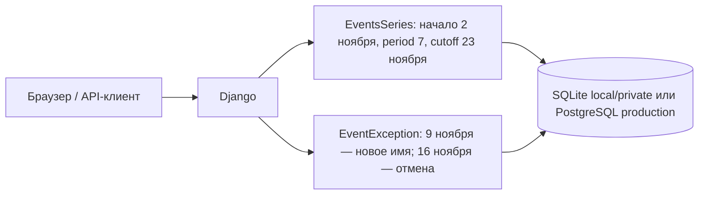

# Демо: еженедельный осмотр линии №2

Продолжительность: 2–3 минуты. Профиль `local`, только демонстрационные данные. Запустите проект по [быстрому запуску](../README.md#быстрый-запуск) и откройте `http://localhost:8000/`. Для чистого кадра используйте новую локальную базу или отдельную копию проекта. Время вводится в UTC.

| Время | Действие в календаре | Что видит зритель | Озвучка |
| --- | --- | --- | --- |
| 0:00–0:35 | Создать «Еженедельный осмотр линии №2», 2 ноября 2026, 09:00 UTC, повтор «еженедельно». | В ноябре видны 2, 9, 16, 23 и 30 ноября с одним названием. | «Одно правило создаёт всю недельную серию; каждый понедельник появляется автоматически». |
| 0:35–1:05 | Открыть 9 ноября и переименовать только этот осмотр в «Повторный осмотр линии №2». | 9 ноября имеет новое имя; 2, 16, 23 и 30 ноября сохраняют исходное. | «Изменение даты хранится отдельно от правила серии». |
| 1:05–1:30 | Открыть 16 ноября и отменить только это повторение. | 16 ноября пусто; 9 ноября остаётся переименованным, 23 и 30 ноября видны. | «Отмена одной даты не затрагивает соседние осмотры». |
| 1:30–2:00 | Открыть 23 ноября и выбрать удаление этого и следующих повторений. | 23 и 30 ноября пусты; 2 и 9 ноября остаются. | «Обрезание включает выбранную дату и все следующие повторы». |
| 2:00–2:30 | Обновить страницу и снова открыть ноябрь. | Итог сохранился: 2 ноября — исходное имя, 9 ноября — новое, 16, 23 и 30 ноября — пусто. | «После перезагрузки видим то же состояние: серия, исключения по датам и дата обрезания сохранены». |

## Кадр со схемой

В кадре покажите схему после календарного результата: одного ID серии достаточно для всех дат. Приложение вычисляет повторы при чтении; отдельных строк для 2, 23 и 30 ноября нет.

Для API-версии этого же сценария используйте [контракт OpenAPI](openapi.yaml). Повторный `POST /add/` создаёт новую серию, поэтому после таймаута сначала проверьте результат операции в приложении.
