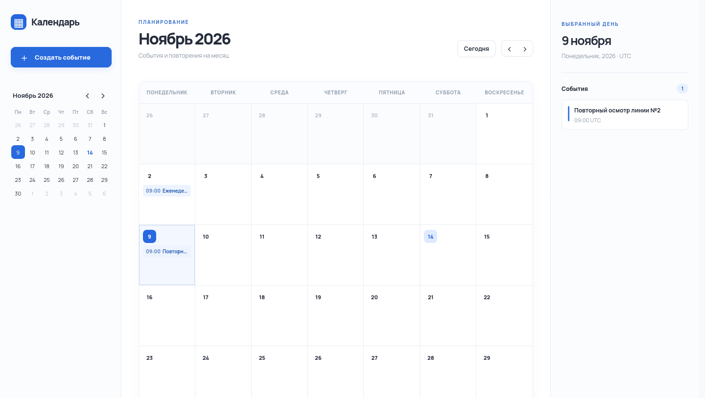
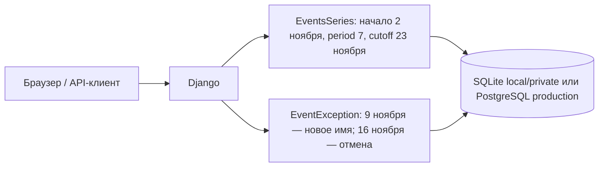

# Демо: еженедельный осмотр линии №2

Профиль `local`, только демонстрационные данные. Запустите проект по [быстрому запуску](../README.md#быстрый-запуск) и откройте `http://localhost:8000/`. Для чистого кадра используйте новую локальную базу или отдельную копию проекта. Время вводится в UTC.

## Записанный ролик — 32 секунды

[Воспроизводимая запись через Playwright](../demo-video/README.md) показывает создание серии с началом 2 ноября 2026 года в 09:00 UTC и периодом 7 дней, переименование 9 ноября, отдельную отмену 16 ноября, обрезание с 23 ноября включительно и результат после перезагрузки. Исходный WebM и MP4 находятся в исключённой из Git папке `demo-video/artifacts/`; параметры и HTTP-проверка приведены в [отчёте о записи](../demo-video/recording-report.md). Ролик без голоса; [текст озвучивания](../demo-video/voiceover.md) и [субтитры](../demo-video/subtitles.srt) подготовлены отдельно.

**Ссылка на ролик после загрузки:** _добавить URL_. Репозиторий приватный: для просмотра материалов в нём проверяющему понадобится доступ. После загрузки отдельно проверьте доступность самой ссылки для проверяющего.

## Ручной сценарий — 2–3 минуты



| Время | Действие в календаре | Что видит зритель | Озвучка |
| --- | --- | --- | --- |
| 0:00–0:35 | Создать «Еженедельный осмотр линии №2», 2 ноября 2026, 09:00 UTC, повтор «еженедельно». | В ноябре видны 2, 9, 16, 23 и 30 ноября с одним названием. | «Одно правило создаёт всю недельную серию; каждый понедельник появляется автоматически». |
| 0:35–1:05 | Открыть 9 ноября и переименовать только этот осмотр в «Повторный осмотр линии №2». | 9 ноября имеет новое имя; 2, 16, 23 и 30 ноября сохраняют исходное. | «Изменение даты хранится отдельно от правила серии». |
| 1:05–1:30 | Открыть 16 ноября и отменить только это повторение. | 16 ноября пусто; 9 ноября остаётся переименованным, 23 и 30 ноября видны. | «Отмена одной даты не затрагивает соседние осмотры». |
| 1:30–2:00 | Открыть 23 ноября и выбрать удаление этого и следующих повторений. | 23 и 30 ноября пусты; 2 и 9 ноября остаются. | «Обрезание включает выбранную дату и все следующие повторы». |
| 2:00–2:30 | Обновить страницу и снова открыть ноябрь. | Итог сохранился: 2 ноября — исходное имя, 9 ноября — новое, 16, 23 и 30 ноября — пусто. | «После перезагрузки видим то же состояние: серия, исключения по датам и дата обрезания сохранены». |

## Кадр со схемой



В кадре покажите схему после календарного результата: одного ID серии достаточно для всех дат. Приложение вычисляет повторы при чтении; отдельных строк для 2, 23 и 30 ноября нет.

## Проверка API через curl

Выполните [быстрый запуск](../README.md#быстрый-запуск) на пустой демонстрационной базе. В другом терминале, из корня проекта, выполните блок целиком. `SERIES_ID` извлекается из ответа `/add/`. Ожидаемые `[]` относятся к пустой демонстрационной базе; в заполненной базе на те же даты могут быть другие события.

```bash
BASE=http://localhost:8000
SERIES_ID=$(
  curl -fsS -X POST "$BASE/add/" \
    -H 'Content-Type: application/json' \
    -d '{"name":"Еженедельный осмотр линии №2","start_at":1793610000,"period":7}' \
  | .venv/bin/python -c 'import json,sys; print(json.load(sys.stdin)["id"])'
)
echo "Series ID: $SERIES_ID"              # POST /add/: 201

curl -i "$BASE/events/2026/11/2/"       # 200: исходный осмотр, id = SERIES_ID
curl -i "$BASE/events/2026/11/9/"       # 200: исходный осмотр, тот же id

curl -i -X POST "$BASE/update/$SERIES_ID/2026/11/9/" \
  -H 'Content-Type: application/json' \
  -d '{"name":"Повторный осмотр линии №2"}' # 204
curl -i "$BASE/events/2026/11/9/"       # 200: новое имя, тот же id
curl -i "$BASE/events/2026/11/2/"       # 200: исходное имя

curl -i -X POST "$BASE/remove/$SERIES_ID/2026/11/16/" # 204
curl -i "$BASE/events/2026/11/16/"      # 200: []

curl -i -X POST "$BASE/remove-next/$SERIES_ID/2026/11/23/" # 204
curl -i "$BASE/events/2026/11/23/"      # 200: []
curl -i "$BASE/events/2026/11/30/"      # 200: []
curl -i "$BASE/events/2026/11/2/"       # 200: исходное имя
curl -i "$BASE/events/2026/11/9/"       # 200: новое имя, тот же id
```

Все пять маршрутов возвращают указанные статусы; ответы трёх изменений `204` не содержат тела. Повторный `POST /add/` после таймаута может создать вторую серию. Обработка такого повтора — вопрос будущей интеграции, описанный в [техническом отчёте](technical-report.md#граница-интеграции-с-cloudmes).
