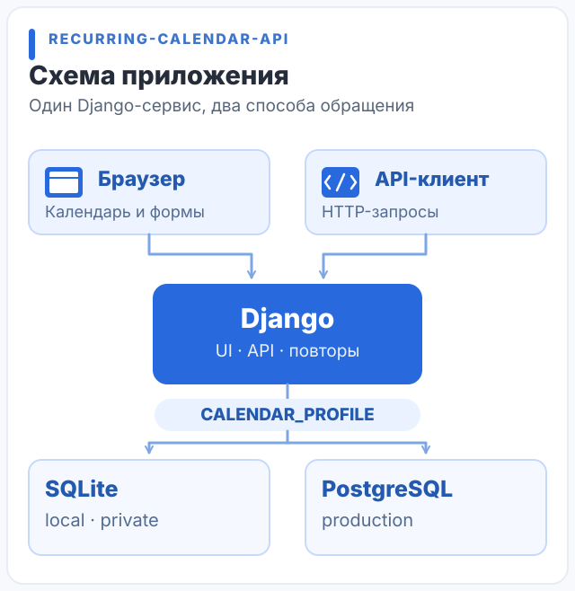

# Технический отчёт к сдаче

Исторический срез документации: `docs/final-readme`, базовый SHA `488918b2e9807acb429346508404f22b8f7fc082` (`origin/main` до последующего merge 17 ноября 2026). Исторические отчёты ниже имеют собственное окружение и не означают повторный прогон на этом SHA.

## Стек и устройство

| Назначение | Фактически используется |
| --- | --- |
| Приложение и интерфейс | Django 5.2.19 (`requirements.txt`), серверные шаблоны, обычные JavaScript и CSS (`events/templates`, `events/static`); Python 3.14 указан в быстром запуске и использован при проверках, но не закреплён в файле зависимостей. |
| Хранение | SQLite в `local` и `private`, PostgreSQL в `production` (`config/settings.py:112–125`); драйвер `psycopg[binary]==3.2.12` закреплён в `requirements.txt`. |
| Развёртывание | `gunicorn==23.0.0`, `whitenoise==6.11.0` закреплены как зависимости приложения; настройки TLS, статики и переменных — в `config/settings.py` и [инструкции](deployment.md). |
| Проверка | Встроенный Django test runner; Firefox, Selenium 4.52.0, WebDriver BiDi, `openapi-spec-validator` и `pip-audit` указаны в отчётах, но отсутствуют в `requirements.txt` и служат инструментами проверки. `scripts/benchmark.py` использует стандартную библиотеку Python. |

В одном запуске Django работает с **одной базой данных**: SQLite при `CALENDAR_PROFILE=local` или `private`, PostgreSQL при `CALENDAR_PROFILE=production`. Выбор делает профиль запуска; данные между этими вариантами автоматически не синхронизируются.

Монолит объединяет HTTP API, календарный интерфейс и правила повторений в одном развёртываемом Django-приложении. Это упрощает локальный запуск; Gunicorn может запускать несколько воркеров с общей PostgreSQL. `EventsSeries` хранит имя, время начала, период **в календарных днях UTC**, владельца и первую исключённую дату `cutoff_date`; `EventException` хранит изменение имени либо отмену для пары «серия, дата» (`events/models.py`). Повторы не материализуются: `occurs_on` вычисляет даты при чтении (`events/views.py:25–32`), чтение дня и месяца подмешивает исключения (`events/views.py:95–169`). `POST /add/` создаёт одну серию и возвращает её ID. Записи изменений выполняются в `transaction.atomic`; на PostgreSQL строка серии блокируется через `select_for_update` (`events/views.py:65–71,172–223`). Обрезание включает переданную дату (`target >= cutoff_date`).

## Контракт и воспроизводимость

Пять маршрутов ТЗ из [OpenAPI](openapi.yaml) соответствуют `config/urls.py:37–41` и обработчикам `events/views.py:120–223`: создание `201 {"id": ...}`, чтение дня `200` с массивом `{"name": ..., "id": ...}` либо `[]`, три изменения `204` без тела. Ошибочные JSON, поля, timestamp и дата дают `400`, невидимый повтор `404`, неверный метод `405`. `start_at` — Unix-секунды UTC; `period` — дни, `null` — одиночное событие. `TIME_ZONE=UTC`, `USE_TZ=True` (`config/settings.py:152–156`). [Сценарий демо](demo.md) согласован с моделью и датами 2, 9, 16, 23, 30 ноября. Пустая выдача сценария предполагает чистую базу. По умолчанию `local` использует `db.local.sqlite3`; `CALENDAR_DB` позволяет указать временную пустую SQLite-базу (`config/settings.py:18,121–125`).

## Результаты проверок и границы доказательств

- [Запись демо 17 ноября 2026](../demo-video/recording-report.md): на исходном SHA `879c0867922153d7b24abf1c40d3464dc65a1bbc` приложение запущено в `local` с отдельной SQLite-базой; действия выполнены через UI, после перезагрузки GET API подтвердил один ID серии для 2 и 9 ноября и пустые ответы для 16, 23 и 30 ноября. MP4 длится 32,4 секунды. Эта запись не проверяет публичное развёртывание или интеграцию CloudMES.
- На тогдашнем базовом SHA `488918b` (Python 3.14.10, Django 5.2.19): `manage.py test events` прошёл в `local` — 19 тестов: 14 выполнено, 5 пропущено; в `private` — 19 тестов: 13 выполнено, 6 пропущено. На новой временной SQLite-базе миграции и `runserver --noreload localhost:8000` прошли; HTTP подтвердил пять маршрутов, даты демо, статусы `200/201/204/400/404/405` и пустую выдачу. Текущие production, Firefox и мобильный прогоны ещё не повторялись.
- [Приёмка 15 ноября](submission-checklist.md): Python 3.14.10, Django 5.2.19; `local` — 18 тестов (14 выполнено, 4 пропущено), `private` — 18 (12/6), `production` на PostgreSQL 17 — 18 (15/3). На временной базе выполнен HTTP-прогон пяти маршрутов со статусами `201/200/204/400/404/405`, Firefox-сценарий с перезагрузкой. Эти результаты относятся к более раннему коду, что указано в отчёте.
- [Ревью следующего изменения](code-review.md): на ветке `refactor/submission-quality` после `d821894` — 19 тестов: `local` 14/5, `private` 13/6, `production` PostgreSQL 17 — 16/3. Firefox проверил также сбой GET после успешного POST. Изменения этой ветки вошли в текущий `origin/main` через `488918b`; это исторический прогон до merge-коммита.
- [Мобильная проверка](../MOBILE_QA.md): headless Firefox, Selenium и WebDriver BiDi, временная SQLite-база; viewport 360×740, 390×740, 360×360, 390×360. `scrollWidth=clientWidth` во всех указанных состояниях; экранная клавиатура реального устройства не проверялась.
- [Нагрузка SQLite](../BENCHMARK_AFTER.md): Python 3.14.9, Django 5.2.19, `runserver --noreload`, дата чтения 2026-01-01, недельные серии; 1/4/8 клиентов. Короткий прогон: 1 000 серий, 12 запросов на сценарий (9 GET + 3 POST в смеси), затем около 10 000 серий, 6 запросов (4 + 2). Длинный прогон: 60 и 30 запросов соответственно, смесь 80% GET / 20% POST. Для длинного чтения при 1 клиенте: 1 000 серий — 98.11 RPS, p95 14.35 мс; 10 036 серий — 14.7 RPS, p95 88.36 мс. При 8 клиентах: 1 024 серии — 47.84 RPS, p95 241.8 мс; 10 048 серий — 5.02 RPS, p95 1747.69 мс. В отчёте есть p50/p99/max, длительность, число событий и HTTP-ошибки; для этих строк ошибок нет. Исходные измерения до оптимизации — [отдельный отчёт](../BENCHMARK.md). Это исторические SQLite-замеры, не PostgreSQL-тест нагрузки и не SLA: выборки малы, 6 запросов дают p95/p99 на уровне максимума.

## Граница интеграции с CloudMES

Сейчас есть документированный [OpenAPI](openapi.yaml). В `local` маршруты анонимны и освобождены от CSRF; `private` и `production` используют сеанс Django, CSRF cookie и `X-CSRFToken`, а чтение и запись ограничены владельцем серии (`config/urls.py:27–41`, `events/views.py:58–71`). Сервисной авторизации и ключей идемпотентности нет. Повторный `POST /add/` после таймаута может создать вторую серию с новым ID, поэтому автоматический retry пока небезопасен.

Перед интеграцией CloudMES должен определить: от чьего имени сервис вызывает API; какие календари и операции ему доступны; какие запросы он повторяет после таймаута и как связывает создание с исходной операцией; ожидаемые число серий, размер выдачи, частоту и параллельность запросов. Затем: (1) согласовать модель доступа и проверить запрещённые чтения/записи тестами двух владельцев; (2) согласовать ключ идемпотентности или иной протокол создания и проверить повтор после потери ответа без дубля; (3) согласовать нагрузочный профиль, прогнать его на PostgreSQL и принять измеримые пороги задержки и ошибок; (4) проверить сквозной контракт, CSRF/авторизацию и восстановление на целевом стенде. Эти критерии относятся к будущей интеграции, не к текущему ТЗ.

## Финальный проход по коду

Блокирующего сдачу дефекта в проверенных маршрутах, моделях и настройках не выявлено. Зависимости в `requirements.txt` используются: Django — приложение, psycopg — PostgreSQL, Gunicorn — WSGI, WhiteNoise — статика; инструменты QA не внесены в runtime-зависимости.

| Приоритет | Место | Последствие и проверка исправления |
| --- | --- | --- |
| Будущая интеграция | `events/views.py:120–142` | `POST /add/` не принимает ключ идемпотентности: повтор после таймаута создаёт дубль. После согласования протокола проверить два одинаковых запроса и потерю первого ответа: в базе остаётся одна серия и возвращается тот же ID. |
| Сопровождение | `events/views.py:95–115,151–169` | Логика отображения исключений повторяется для дня и диапазона; будущая правка может разойтись. Проверять одинаковый результат обоих маршрутов для переименования, отмены и обрезания. Текущие тесты семантику покрывают. |

В `MOBILE_QA.md:3` обнаружена ссылка на отсутствующий файл метрик; ссылка удалена, опубликованные таблица и скриншоты оставлены. Повторный мобильный прогон нужен для новых сырых метрик.

При публикации итогового коммита следует повторить тесты трёх профилей на его SHA, HTTP-прогон на пустой SQLite-базе, Firefox и мобильные viewport при изменении интерфейса, проверку OpenAPI, ссылок и `git diff --check`; для production отдельно подтвердить PostgreSQL, сборку статики и конфигурацию целевого стенда. Актуальные запуски CI доступны в [GitHub Actions](https://github.com/BorDch/recurring-calendar-api/actions); статус будущего коммита определяется после публикации.
